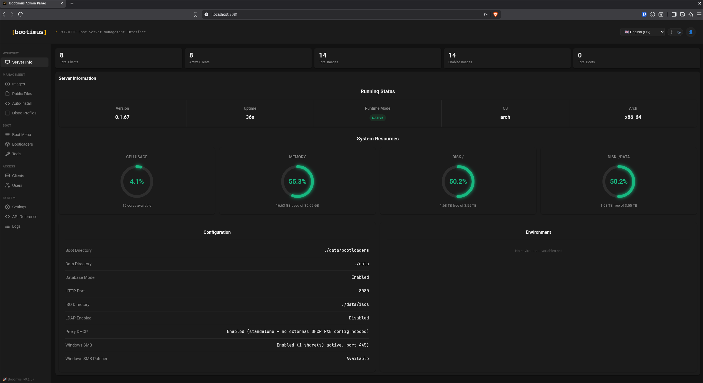
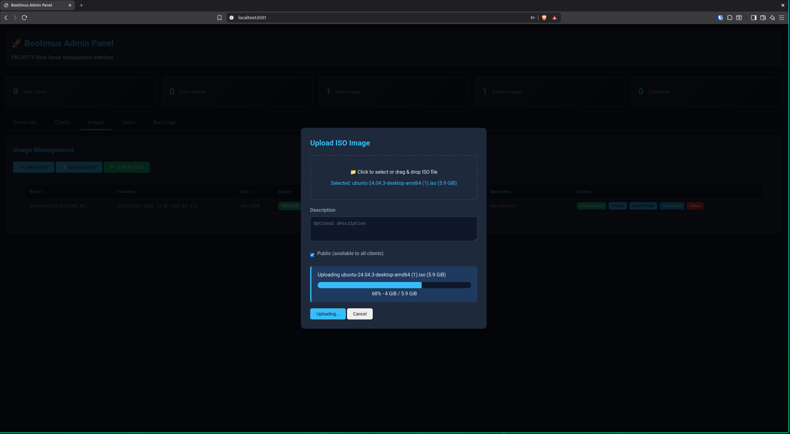
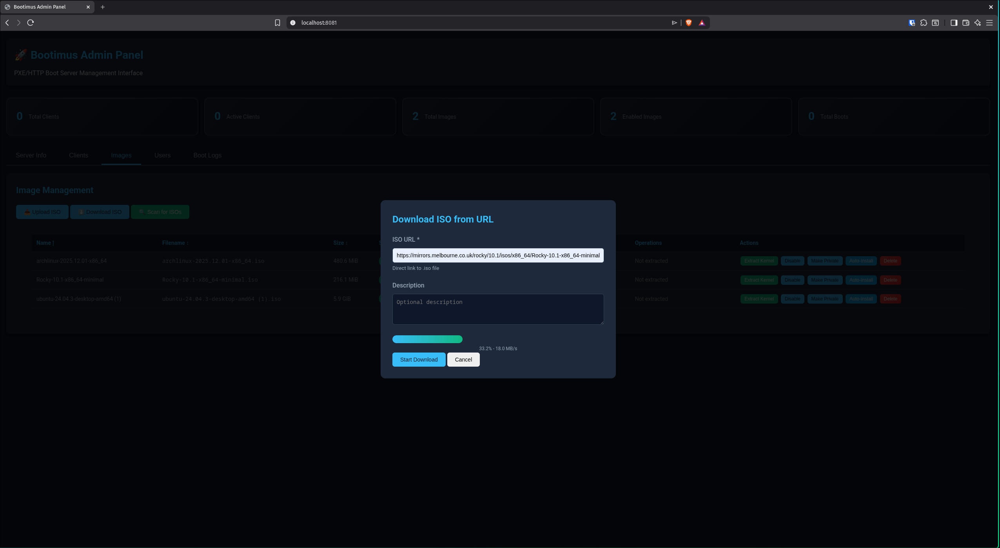

<p align="center">
  
</p>

# Modern PXE/HTTP Boot Server

**A production-ready, self-contained PXE and HTTP boot server** written in Go with embedded iPXE bootloaders, SQLite/PostgreSQL support, and a full-featured web admin interface. Deploy in seconds with a single binary or Docker container.

## Website live
### [https://bootimus.com/](https://bootimus.com/)

## There Be Dragons!

This is an early-stage work-in-progress project - there may be bugs. Please raise an issue for any unexpected behaviour you encounter.

### AI Disclosure

I've used Claude CLI to help with some parts of this project - mostly making the web UI pretty, as I'm NOT a frontend developer. I also used it to generate the docs, but I review them manually - no automatically-generated AI code goes into the project without review from myself.

## Features

- **Single binary, zero config**: Everything bundled - bootloaders, web UI, database. Just run it
- **Standalone PXE**: Built-in proxyDHCP responder lets Bootimus drive PXE on any LAN without touching the existing DHCP server
- **50+ distro support**: Automatic kernel/initrd extraction with a generic fallback scanner for unknown ISOs, plus OpenBSD and NetBSD netboot through their own loaders (new, feedback welcome)
- **Unattended Windows install** (opt-in): PXE-boot Windows 10/11 end-to-end — Bootimus hosts the install media over SMB and auto-launches `setup.exe`. Requires `samba` on the host (bundled in the Docker image)
- **Built-in diagnostic tools**: GParted, Clonezilla, Memtest86+, SystemRescue, ShredOS, Netboot.xyz - one-click download and enable from the admin UI
- **Custom tools**: Add your own PXE-bootable tools with configurable boot methods (kernel, chain, memdisk)
- **WinPE and rescue media**: Boot Strelec, Active@ Boot Disk and other wimboot-compatible ISOs, choosing which WIM to load
- **Checksums and update notices**: Downloads from the catalogue are verified against SHA-256 checksums, and images and tools show a badge when a newer release is available
- **Per-client access control**: Assign specific images per MAC address, toggle public image visibility per client
- **Deployment profiles**: Bundle an image, auto-install file, SAN target, bootloader set and a first-boot action, assign the bundle to clients or groups, and it is resolved at every boot
- **Auto-enrolment rules**: Match new machines on MAC prefix, manufacturer, product, serial, UUID or firmware and drop them into the right group and profile, named and static, on their first boot
- **Client auto-discovery**: Clients are automatically detected when they PXE boot, like DHCP leases - promote to static when ready
- **Next boot action**: Set a one-time boot image for a client with optional Wake-on-LAN - auto-clears after use
- **Disk capture and deploy**: Image a client's disk with the bundled Clonezilla and restore it to one client or a whole client group on their next PXE boot
- **iSCSI and AoE boot**: Point a client or group at a SAN target, with CHAP, and make it the default boot entry
- **Install completion tracking**: Kickstart, preseed, cloud-init and autounattend call back when an install finishes, so each client shows its install state and fires a webhook
- **BMC power control**: Power clients on, off or restart them over Redfish or Intel AMT, per client or in bulk across a client group
- **Remote console**: Open an Intel AMT Serial-over-LAN or IPMI console in the browser straight from the client page
- **Boot menu preview**: See the exact iPXE script any client would receive, without touching its state
- **PXE Debug page**: Every DHCP request the built-in proxyDHCP sees, with the decision taken, live in the admin UI
- **Hardware inventory**: Automatic collection of CPU, memory, manufacturer, serial number, and NIC info from PXE clients
- **JWT authentication**: Secure token-based auth with a dedicated login page, optional TOTP two-factor and lockout after repeated failed logins
- **API tokens**: Long-lived read-only or admin tokens for scripts and integrations, revocable at any time
- **Admin TLS**: Serve the admin interface over HTTPS with your own certificate or a generated self-signed one
- **LDAP/Active Directory**: Optional LDAP backend with group-based admin access - local accounts always work as fallback
- **OIDC single sign-on**: Sign in through Authentik, Keycloak, Microsoft Entra ID, Google or any OpenID Connect provider, with users created on first sign-in and admin rights mapped from groups or user lists
- **Read-only role**: Non-admin users can view clients, images and boot activity without being able to change anything or see BMC passwords
- **Audit log**: Every change made through the admin API is recorded with user, action and result, and can be forwarded as a webhook
- **Housekeeping**: Configurable retention for boot logs, inventory history, audit entries and stale discovered clients, with a data directory usage view
- **Backup and restore**: Download a backup of the database and settings, and restore one from the UI
- **Multi-site**: Read-only replicas at branch sites mirror a primary and boot local clients from local copies
- **Swappable bootloaders**: Ship with embedded iPXE, or bring your own custom bootloader sets
- **Raspberry Pi netboot**: Pi 3 and Pi 4 boards boot with no SD card — embedded UEFI firmware served over TFTP
- **Modern admin UI**: Sidebar navigation, consistent toolbars, real-time colour-coded logs, REST API with a generated OpenAPI document
- **Multi-database**: SQLite out of the box, PostgreSQL for production
- **Docker and bare metal**: Multi-arch images (amd64/arm64) or a single static binary

## Screenshots

| Admin Dashboard | Upload ISOs | Download from URL |
|----------------|-------------|-------------------|
|  |  |  |

## Quick Start

### Docker (Recommended)

```bash
# Create data directory
mkdir -p data

# Run with SQLite (no database container needed)
docker run -d \
  --name bootimus \
  --cap-add NET_BIND_SERVICE \
  -p 69:69/udp \
  -p 8080:8080/tcp \
  -p 8081:8081/tcp \
  -v $(pwd)/data:/data \
  garybowers/bootimus:latest

# Check logs for admin password
docker logs bootimus | grep "Password"

# Access admin interface
open http://localhost:8081
```

A docker logo is available, see Bootimus `bootimus_logo.png`.
Ex.: it can be used with unraid with: https://raw.githubusercontent.com/garybowers/bootimus/logos/bootimus_logo_square_ulow.png

On Unraid you can find an App/Template called "bootimus" for easy installation. Consider using a "custom network" with an dedicated ip address for bootimus docker.

### Standalone Binary

```bash
# Download binary
wget https://github.com/garybowers/bootimus/releases/latest/download/bootimus-amd64
chmod +x bootimus-amd64

# Run (SQLite mode - no database required)
./bootimus-amd64 serve

# Admin panel: http://localhost:8081
```

Install `bsdtar` (`libarchive-tools` on Debian/Ubuntu, `libarchive` on Arch and Fedora) alongside the binary. Bootimus uses it to extract ISOs with their full Rock Ridge and Joliet file names; without it, extraction falls back to a built-in reader that can shorten long names on some ISOs, which breaks RPM repositories. The Docker image already includes it.

### Docker Compose

```bash
git clone https://github.com/garybowers/bootimus
cd bootimus
docker-compose up -d
```

### Archlinux aur packages

[](https://aur.archlinux.org/packages/bootimus/)
[](https://aur.archlinux.org/packages/bootimus-bin/)

bootimus is available on the [AUR](https://wiki.archlinux.org/index.php/Arch_User_Repository):
- [bootimus](https://aur.archlinux.org/packages/bootimus/) (release package with systemd integration)
- [bootimus-bin](https://aur.archlinux.org/packages/bootimus-bin/) (standalone binary release package)

You can install it using your [AUR helper](https://wiki.archlinux.org/index.php/AUR_helpers) of choice.

Example:
```shell
$ yay -Sy bootimus

# Edit /etc/bootimus/bootimus.yaml with your preference

# And start the service
$ systemctl start bootimus
```

## Documentation

- **[Deployment Guide](docs/en/deployment.md)** - Docker, binary, networking, and storage
- **[Image Management](docs/en/images.md)** - Upload ISOs, extract kernels, netboot support
- **[USB Appliance](docs/en/appliance.md)** - Flashable Alpine+bootimus image for portable PXE servers
- **[Admin Console](docs/en/admin.md)** - Web UI and REST API reference
- **[DHCP Configuration](docs/en/dhcp.md)** - Configure your DHCP server
- **[Auto-Install](docs/en/auto-install.md)** - autounattend.xml, cloud-init, kickstart, preseed
- **[Client Management](docs/en/clients.md)** - MAC-based access control, auto-discovery, next boot
- **[Multi-Site](docs/en/multi-site.md)** - Read-only branch replicas that mirror a primary
- **[Disk Imaging](docs/en/disk-imaging.md)** - Capture a client's disk with Clonezilla and deploy it to one client or a whole group
- **[App Releases](docs/en/releases.md)** - Version preparation, release checks and prerelease publishing
- **[Deployment Profiles](docs/en/deployment-profiles.md)** - Profiles that bundle image, auto-install file, SAN target, bootloader set and first-boot action, and rules that enrol new machines into them
- **[Authentication](docs/en/authentication.md)** - JWT auth, LDAP/Active Directory and OIDC single sign-on setup
- **[Distro Profiles](docs/en/distro-profiles.md)** - Data-driven distro detection and boot params

## Boot Tools

Bootimus includes a built-in tools system for diagnostic and utility software. Tools can be downloaded and enabled from the admin UI under the **Tools** section. When enabled, they appear in a **Tools** submenu in the PXE boot menu.

| Tool | Description |
|------|-------------|
| **GParted Live** | Partition editor for managing disk partitions |
| **Clonezilla Live** | Disk cloning and imaging |
| **Memtest86+** | Memory testing and diagnostics |
| **SystemRescue** | Full rescue toolkit (file recovery, disk repair, network tools) |
| **ShredOS** | Secure disk wiping based on nwipe |
| **Netboot.xyz** | Chainloads into hundreds of OS installers and tools |

Download URLs are shown in the UI and can be overridden to point at local mirrors or newer versions.

### Custom Tools

You can add your own PXE-bootable tools via the **"+ Add Custom Tool"** button in the Tools section. Custom tools support:

- **Boot methods**: Kernel/initrd, chain (EFI), or memdisk
- **Archive types**: ZIP, single binary, or ISO
- **Boot parameters**: With `{{HTTP_URL}}` placeholder for server URL substitution
- **Download from URL**: Specify any HTTP/HTTPS URL for the tool files

## Bootloader Management

Bootimus ships with embedded iPXE bootloaders for UEFI (x86_64, ARM64) and Legacy BIOS. You can also use custom bootloader sets:

1. Create a subfolder in `{data-dir}/bootloaders/` (e.g. `ipxe-custom/`)
2. Place your custom bootloader files in it
3. Select the set from the **Bootloaders** section in the admin UI

The built-in set is always available as a fallback. Files not present in the active custom set are served from the built-in set automatically.

When the built-in proxyDHCP server is enabled, clients can override the global
set from the **Clients** page. Client settings take precedence over client-group
settings, which take precedence over the globally active set. External DHCP
servers cannot apply MAC-specific Bootimus settings and continue to use the
globally active set.

## Supported Distributions

### Arch-based
- Arch Linux, CachyOS, EndeavourOS, Manjaro, Garuda, Artix, BlackArch, Parabola, SteamOS

### Debian/Ubuntu-based
- Ubuntu (all flavours), Debian, Linux Mint, Pop!_OS, Kali, Parrot, Zorin, elementary OS, MX Linux, antiX, Devuan, PureOS, Deepin, LMDE, TrueNAS SCALE, Proxmox

TrueNAS SCALE uses a dedicated installer profile. SCALE 25.10.2.1 was tested through installation and disk boot in UEFI QEMU with 8 GiB RAM; see the [Image Management Guide](docs/en/images.md#detection-patterns) for requirements and existing-image updates.

### Red Hat-based
- Fedora, CentOS, Rocky Linux, AlmaLinux, Oracle Linux, Nobara, Mageia

### Other Linux
- openSUSE, NixOS, Alpine, Gentoo, Void, Slackware, Solus, Tiny Core, Clear Linux

### Other
- FreeBSD
- **OpenBSD and NetBSD** (new, feedback welcome) — booted through their own PXE loaders served over TFTP, see the [Image Management Guide](docs/en/images.md#openbsd-and-netbsd)
- **Windows 10/11** (via wimboot) — optional unattended install via SMB (see the [Windows Unattended Install](#windows-unattended-install---windows-smb) section). Needs `samba` on the host if enabled.

For distributions not in this list, the **generic boot scanner** automatically walks the ISO filesystem to find kernel and initrd files and attempts to extract boot parameters from syslinux/grub configuration files.

Need to add a new distro? Create a **custom distro profile** from the admin UI — no code change required. See the [Distro Profiles Guide](docs/en/distro-profiles.md). You can also contribute profiles to the official list via pull request.

## ISO Organisation

ISOs can be organised into groups by placing them in subdirectories:

```
data/isos/
├── ubuntu-24.04.iso              # ungrouped, appears in main menu
├── linux/                        # creates "linux" group
│   ├── debian-12.iso             # in "linux" submenu
│   └── servers/                  # creates "servers" subgroup
│       └── truenas-scale.iso     # in "linux > servers" submenu
└── windows/                      # creates "windows" group
    └── win11.iso                 # in "windows" submenu
```

Groups are auto-created on startup and when scanning for ISOs. They can also be managed manually via the admin UI.

## Windows Unattended Install (`--windows-smb`)

Off by default. When enabled, bootimus starts an isolated `smbd` child process that exposes each extracted Windows ISO as a read-only guest SMB share, and patches the WinPE `boot.wim` so `setup.exe` auto-mounts that share and runs — no manual `net use` from the WinPE prompt, no keyboard input after PXE.

### Dependency

This feature requires **Samba** on the host. The Docker image ships `samba` out of the box. Standalone Linux users install it manually:

```bash
# Debian / Ubuntu
sudo apt install samba

# Arch
sudo pacman -S samba

# Fedora / RHEL
sudo dnf install samba
```

If `smbd` isn't in `PATH`, the feature self-disables with a clear log line and the rest of bootimus runs normally — nothing else depends on samba.

### Additional requirements

- `wimlib-imagex` (already required for Windows driver injection).
- Port 445 reachable from clients. Windows' `net use` ignores non-445 SMB ports, so `--windows-smb-port` is for testing only.
- `smbd` listens on `--bind-interface` when it is set. Otherwise it binds to `--server-addr` if that address belongs to this host, and listens on all interfaces when it does not (for example under Kubernetes, where the advertised address is a node or service IP the pod does not own).
- If running standalone with `setcap` instead of root, grant `smbd` the same capability so the forked child can bind 445:

  ```bash
  sudo setcap 'cap_net_bind_service=+eip' /usr/sbin/smbd
  ```

  (Docker users skip this — the image runs as root.)

### Enabling

```bash
# Standalone
./bootimus serve --windows-smb

# Config file (bootimus.yaml)
windows_smb:
  enabled: true
  port: 445
```

**Docker Compose** — uncomment both the env var and the port mapping in [docker-compose.yml](docker-compose.yml):

```yaml
services:
  bootimus:
    environment:
      BOOTIMUS_WINDOWS_SMB_ENABLED: "true"
    ports:
      - "445:445/tcp"
```

### Admin UI

- **Settings tab** shows live SMB status: `Enabled (N shares, port 445)`, `Disabled`, or `Requested but unavailable` if `smbd` is missing.
- Patched Windows ISOs get an **SMB** chip in the image list.
- The image-properties panel gains a **Patch SMB** / **Re-patch SMB** button for applying (or re-applying) the boot.wim patch without re-extracting.

## Roadmap

- iPXE colour theming (blocked on iPXE firmware compatibility)

## Why Bootimus Over iVentoy?

| Feature | Bootimus | iVentoy |
|---------|----------|---------|
| **Language** | Go | C |
| **Single Binary** | Yes | No |
| **Embedded Bootloaders** | Yes | No |
| **Standalone PXE** | Built-in proxyDHCP — no DHCP reconfig needed | Requires external DHCP changes |
| **Database** | SQLite / PostgreSQL | File-based |
| **Web UI** | Modern sidebar UI with REST API | Basic HTML |
| **Authentication** | JWT + LDAP/AD + OIDC SSO, TOTP two-factor, API tokens | None |
| **Admin TLS** | Built in, with self-signed option | No |
| **Audit Log** | Every admin change recorded | No |
| **Boot Logging** | Full tracking with live streaming | Limited |
| **MAC-based ACL** | Granular per-client | No |
| **ISO Upload** | Web upload + URL download | Manual copy |
| **Boot Tools** | GParted, Clonezilla, Memtest86+, etc. | No |
| **Disk Imaging** | Clonezilla capture and deploy from the UI | No |
| **Remote Console** | AMT Serial-over-LAN and IPMI in the browser | No |
| **Multi-Site** | Read-only branch replicas | No |
| **Bootloader Management** | Swappable sets via UI | No |
| **Docker Support** | Multi-arch | Limited |
| **API-First** | RESTful API with OpenAPI document | No |
| **Licence** | Apache 2.0 | GPL |

## DHCP Configuration

Bootimus has two options for the DHCP side of PXE.

### Option 1: Built-in proxyDHCP (recommended)

Bootimus ships with a built-in proxyDHCP responder. Enable it and your existing DHCP server (router, Pi-hole, Windows DHCP, anything) needs **zero PXE configuration** — it keeps handing out IPs as normal, and Bootimus answers only the PXE-specific bits on the same broadcast domain.

```bash
bootimus serve --proxy-dhcp
# or: BOOTIMUS_PROXY_DHCP_ENABLED=true
```

Binds UDP/67; needs `CAP_NET_BIND_SERVICE` or root. Off by default so existing installs aren't surprised.

### Option 2: Configure your DHCP server manually

If you'd rather keep PXE config on your existing DHCP server, point it at Bootimus. Example for ISC DHCP:

```conf
subnet 192.168.1.0 netmask 255.255.255.0 {
    range 192.168.1.100 192.168.1.200;
    next-server 192.168.1.10;  # Bootimus server IP

    # Chain to HTTP after iPXE loads
    if exists user-class and option user-class = "iPXE" {
        filename "http://192.168.1.10:8080/menu.ipxe";
    }
    # UEFI systems
    elsif option arch = 00:07 or option arch = 00:09 {
        filename "ipxe.efi";
    }
    # Legacy BIOS
    else {
        filename "undionly.kpxe";
    }
}
```

See [DHCP Configuration Guide](docs/en/dhcp.md) for Dnsmasq, MikroTik, Ubiquiti, and more.

## Building from Source

```bash
# Clone repository
git clone https://github.com/garybowers/bootimus
cd bootimus

# Build and run locally
make build
make run

# Build container image locally
make docker-build

# Start services via docker compose
make docker-up

# Build all platform binaries for GitHub release
make release

# Build and push multi-arch container to Docker Hub
make docker-push

# Push amd64 only (faster, skips arm64 QEMU emulation)
make docker-push PLATFORMS=linux/amd64
```

Run `make help` for all available targets.

## Security Considerations

- **Read-only TFTP**: TFTP server is read-only (no write operations)
- **Path sanitisation**: All file paths sanitised to prevent directory traversal
- **MAC address verification**: ISOs served only to authorised clients
- **Admin authentication**: JWT token-based auth with bcrypt password hashing, optional LDAP/AD backend, OIDC single sign-on and TOTP two-factor for local accounts
- **Brute-force protection**: Repeated failed logins lock the account and the client address for an escalating period
- **Scoped API tokens**: Read-only or admin tokens for automation, hashed at rest and revocable
- **Admin TLS**: HTTPS on the admin port with your own certificate or a generated self-signed one
- **Separate admin port**: Admin interface isolated from boot network
- **Audit logs**: All boot attempts logged with client/image/success tracking, and every admin change recorded with user, action and result

## Troubleshooting

### Permission Denied on Port 67 or 69

Bootimus binds privileged UDP ports: 69 for TFTP, and 67 if `--proxy-dhcp` is enabled.

```bash
# Run as root
sudo ./bootimus serve

# Or grant capabilities once to the binary
sudo setcap 'cap_net_bind_service=+ep' ./bootimus

# Or use Docker with NET_BIND_SERVICE (default image already runs as root)
docker run --cap-add NET_BIND_SERVICE ...

# Or use a non-privileged TFTP port
./bootimus serve --tftp-port 6969
```

### Address Already in Use on Port 67

Another DHCP server is already bound to UDP 67, most often dnsmasq started by libvirt, NetworkManager or Docker Desktop. Check with `ss -lunp 'sport = :67'`. Bind Bootimus to your LAN interface only and the two coexist:

```bash
./bootimus serve --proxy-dhcp --bind-interface enp2s0
```

The same setting is `bind_interface` in `bootimus.yaml` or `BOOTIMUS_BIND_INTERFACE`.

### Client Not Booting / No PXE Offer

Most common first-time PXE failures:

```bash
# 1. Check Bootimus is seeing the client's DHCP request
docker logs bootimus | grep -E 'proxyDHCP|TFTP'

# 2. Same broadcast domain — PXE DHCP is L2 broadcast.
#    In Docker, the container must use macvlan/ipvlan or network_mode: host.
#    The default bridge network will NOT work; docker0 traps broadcasts.

# 3. Two DHCP servers advertising PXE? Pick one.
#    If proxyDHCP is enabled, strip PXE options from your router's DHCP.

# 4. Firewall
sudo ufw allow 67/udp    # proxyDHCP (if enabled)
sudo ufw allow 69/udp    # TFTP
sudo ufw allow 8080/tcp  # HTTP boot

# 5. Check the client can reach HTTP
curl -v http://<bootimus-ip>:8080/menu.ipxe
```

### No ISOs in Menu

```bash
# Check data directory
ls -la data/isos/

# Scan for ISOs via API
curl -H "Authorization: Bearer $TOKEN" -X POST http://localhost:8081/api/scan

# Enable public access to images
curl -H "Authorization: Bearer $TOKEN" -X PUT http://localhost:8081/api/images?filename=ubuntu.iso \
  -H "Content-Type: application/json" \
  -d '{"public": true, "enabled": true}'
```

### UEFI Secure Boot Enabled on Target

Bootimus ships a built-in `secureboot-official` bootloader set — a Microsoft-signed shim chain that stock Secure Boot firmware trusts out of the box, with no certificate enrolment on clients.

**Fix**: select the `secureboot-official` set on the Bootloaders page (external DHCP servers must advertise `ipxe-shimx64.efi` to UEFI clients), and use extracted kernel/initrd boot for your images. See the [Secure Boot guide](docs/en/secure-boot.md) for the full walkthrough and limitations (NBD/NFS boots and distros without Secure Boot support still need it disabled).

### Forgotten Admin Password

```bash
# Prints a fresh random password to the logs, then continues starting
./bootimus serve --reset-admin-password

# Via Docker
docker exec bootimus bootimus serve --reset-admin-password
docker logs bootimus | grep "New Password"
```

### Database Connection Failed

```bash
# Check SQLite database
ls -la data/bootimus.db

# For PostgreSQL, test connection
psql -h localhost -U bootimus -d bootimus
```

## Licence

Licensed under the Apache Licence, Version 2.0. See [LICENSE](LICENSE) for details.

Copyright 2025-2026 Bootimus Contributors

## Contributing

Contributions welcome! Please open an issue or pull request.

## Links

- **GitHub**: https://github.com/garybowers/bootimus
- **Docker Hub**: https://hub.docker.com/r/garybowers/bootimus
- **Documentation**: https://github.com/garybowers/bootimus/tree/main/docs
